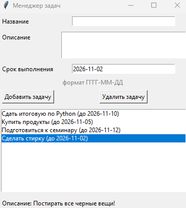

# Task Manager

Простое приложение для управления задачами (Tkinter).
Задачи можно добавлять и удалять, они автоматически сохраняются в файл `tasks.json`
и загружаются при следующем запуске.

Автор: *ФИО, группа*

## Запуск

1. Установите Python 3.x (tkinter входит в стандартную установку).
2. (Необязательно) для выбора даты в календаре установите библиотеку:
   `pip install -r requirements.txt`.
   Без неё дату можно вводить вручную в формате `ГГГГ-ММ-ДД`.
3. Запустите `gui.py`:
   ```
   python gui.py
   ```
4. Добавляйте задачи через форму, удаляйте выбором в списке.

## Функциональность

- Добавление и удаление задач.
- Проверка формата даты и обязательных полей.
- Описание выбранной задачи показывается под списком.
- Автосохранение в JSON-файл `tasks.json`.

## Структура проекта

| Файл | Назначение |
|------|------------|
| `classes.py` | Классы `Task` (задача) и `TaskManager` (список задач, чтение и запись файла) |
| `gui.py` | Окно приложения на Tkinter |
| `tasks.json` | Файл с задачами |
| `test_classes.py` | Тесты (`python -m unittest`) |

## Скриншот

<!-- Добавьте скриншот окна:  -->
